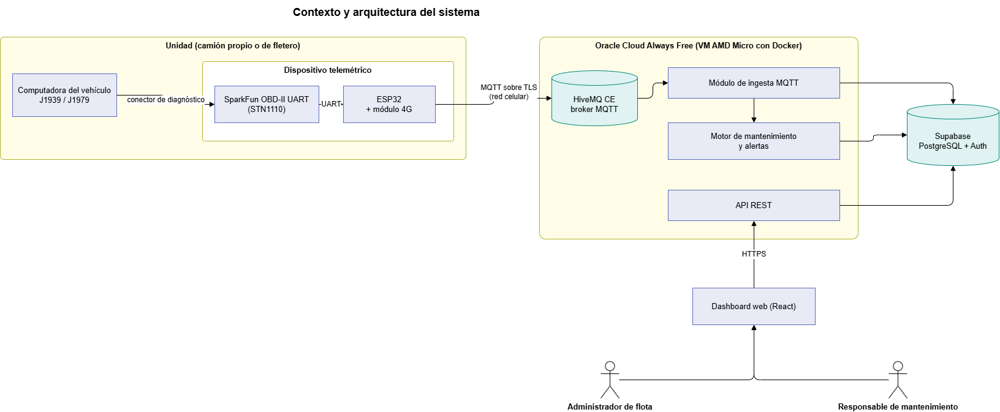

# Sistema de Telemetría Vehicular para el Mantenimiento Preventivo de Flotas Mixtas

Trabajo Final Integrador — Tecnicatura Universitaria en Programación a Distancia (UTN)

Las pymes de transporte con flotas mixtas (camiones de distintas marcas, propios y de terceros) suelen controlar el mantenimiento preventivo con registros manuales, porque la telemetría de fábrica solo cubre a las unidades recientes de cada marca. Este proyecto propone un dispositivo independiente de la marca que lee kilometraje, horas de motor y códigos de falla desde el conector de diagnóstico del vehículo (SAE J1939 / J1979), los transmite por MQTT a la nube y calcula automáticamente el estado de mantenimiento de cada unidad en un dashboard web.

**Producción:** https://157-151-13-187.sslip.io (estado del servicio en [`/health`](https://157-151-13-187.sslip.io/health))

## Integrantes

- **Patricio Sussini Guanziroli** — hardware y firmware, frontend
- **Matias Ezequiel Vazquez** — backend, bases de datos e infraestructura

**Tutor:** Sebastián Bruselario

## Documentación

| Documento | Contenido |
|---|---|
| [1ª Entrega — Propuesta de proyecto](docs/entregas/01-propuesta-proyecto.md) | Problemática y evidencia (caso de estudio), propuesta de valor, actores, alcance, requerimientos funcionales y no funcionales, reglas de negocio, casos de uso, plan de trabajo y ficha de la entrevista. |
| [2ª Entrega — Arquitectura y módulos](docs/entregas/02-arquitectura-modulos.md) | Esquema de base de datos (PostgreSQL/Supabase), listado de módulos y contrato del mensaje MQTT. |
| [Contrato de la API](docs/openapi.yaml) | Especificación OpenAPI de la API REST, compartida por el backend, el mock y el frontend. |
| [Prototipo del backend](docs/prototipo-backend.md) y [del frontend](docs/prototipo-frontend.md) | Endpoints y pantallas a partir de los casos de uso. |
| [Despliegue](docs/despliegue.md) | Puesta en producción en Oracle Cloud: Docker, HiveMQ CE, Caddy y certificados. |
| [Diagramas](docs/diagramas/) | Diagramas en PNG, con sus archivos editables en draw.io. |

## Arquitectura



```
Computadora del vehículo (SAE J1939 / J1979)
    → SparkFun OBD-II UART (STN1110)
    → ESP32 (UART) + módulo 4G
    → HiveMQ CE (MQTT sobre TLS, autoalojado en la VM)
    → Backend en Oracle Cloud VM (ingesta MQTT + motor de mantenimiento + API REST)
    → Supabase (PostgreSQL + Auth)
    → Dashboard web (React), servido por Caddy en el mismo dominio que la API
```

## Stack tecnológico

| Capa | Tecnología |
|---|---|
| Hardware | ESP32, SparkFun OBD-II UART (STN1110), módulo 4G |
| Frontend | React 19, TypeScript, Vite, Tailwind CSS, TanStack Query |
| Backend | Node.js 22+, TypeScript, Express 5, postgres.js, mqtt.js |
| Base de datos y autenticación | Supabase (PostgreSQL + Auth) |
| Mensajería IoT | MQTT, broker HiveMQ CE con la extensión File RBAC |
| Despliegue | Oracle Cloud Always Free (VM AMD Micro), Docker Compose, Caddy (HTTPS con Let's Encrypt) |

### Cambios respecto de lo planificado

| Planificado | Implementado | Motivo |
|---|---|---|
| HiveMQ Cloud | HiveMQ CE autoalojado | HiveMQ Cloud dejó de ofrecer un plan gratuito (RNF12). |
| VM ARM (A1.Flex) | VM AMD Micro (E2.1.Micro) | Sin capacidad ARM disponible en la región. Entra con 2 GB de swap y límites de memoria por contenedor. |
| JavaScript, Express / NestJS | TypeScript, Express 5 | Tipado estático compartido con el frontend. Express alcanza para el tamaño de la API. |

## Estructura del repositorio

```
.
├── README.md
├── backend/                 # API REST + ingesta MQTT + temporizador (ver backend/README.md)
├── frontend/                # Dashboard web (ver frontend/README.md)
├── mock/                    # API simulada para desarrollar el frontend sin backend
├── db/
│   ├── schema.sql           # DDL: 12 tablas, restricciones e índices, con RLS habilitado
│   └── seed.sql             # DML: flota de ejemplo (generado por backend/scripts/seed.ts)
├── deploy/                  # Producción: docker-compose, Caddy, HiveMQ y renovación de certificados
└── docs/
    ├── entregas/            # Informes de cada instancia de entrega
    ├── diagramas/           # Diagramas en PNG (fuentes .drawio en drawio/)
    └── openapi.yaml         # Contrato de la API REST
```

## Base de datos

El esquema completo está en [`db/schema.sql`](db/schema.sql) y los datos de ejemplo en [`db/seed.sql`](db/seed.sql). Row Level Security está habilitado en todas las tablas, sin políticas: ningún cliente (dashboard, mobile, etc.) accede directo a la base. Solo el backend se conecta, con la cadena de conexión de PostgreSQL. El dashboard usa Supabase únicamente para iniciar sesión.

## Instalación y ejecución

Requisitos: Node.js 22 o superior, y Docker para la base y el broker locales.

### Backend

```bash
cd backend
npm install
cp .env.example .env                              # completar DATABASE_URL (Supabase o local)
docker compose -f docker-compose.dev.yml up -d    # opcional: PostgreSQL y HiveMQ CE locales
npm run dev                                       # http://localhost:3000/api/v1
npm test
```

Detalle de la configuración, el simulador de flota y los tests en [`backend/README.md`](backend/README.md).

### Frontend

```bash
cd frontend
npm install
cp .env.example .env      # VITE_API_URL=http://localhost:3000/api/v1
npm run dev               # http://localhost:5173
```

El frontend funciona igual contra el backend (con `AUTH_MODE=dev`) o contra el mock (`node mock/server.js`). Los dos escuchan en el puerto 3000, así que hay que levantar uno solo. Ver [`frontend/README.md`](frontend/README.md).

### Producción

Ver [`docs/despliegue.md`](docs/despliegue.md).

## Estado del proyecto

| Componente | Estado |
|---|---|
| Documentación (1ª y 2ª entrega) | Completa |
| Base de datos | Esquema y datos de ejemplo aplicados en Supabase |
| Backend | Completo: API REST (M1, M2, M4–M7, M9), ingesta MQTT (M3) y temporizador (M8). 39 tests. Desplegado en producción. |
| Infraestructura | VM de Oracle con HiveMQ CE (TLS y usuarios por dispositivo), Caddy con HTTPS y renovación automática de certificados |
| Frontend | Login con Supabase Auth, flota, detalle de unidad y alertas. Carga manual de kilometraje, postergación de tareas, registro de services, historial de mantenimiento y administración de unidades, dispositivos, catálogo de tareas y planes de mantenimiento. Pendiente: administración de usuarios |
| Firmware | Pendiente |