# Tecnicatura Universitaria en Programación a Distancia
### Trabajo Final Integrador
**Entrega Final - Informe**

# Sistema de Telemetría Vehicular para el Mantenimiento Preventivo de Flotas Mixtas

| | |
|---|---|
| **Universidad** | Universidad Tecnológica Nacional (UTN) |
| **Carrera** | Tecnicatura Universitaria en Programación a Distancia |
| **Materia** | Proyecto Final |
| **Proyecto** | Sistema de Telemetría Vehicular para el Mantenimiento Preventivo de Flotas Mixtas |
| **Grupo** | N.º 147 |
| **Integrantes** | Patricio Sussini Guanziroli · Matias Ezequiel Vazquez |
| **Tutor** | Sebastián Bruselario |
| **Año** | 2026 |
| **Repositorio** | https://github.com/MatiasEzequielVazquez/tup-tfi-telemetria (versión entregada: `v1.0.0`) |
| **Sistema desplegado** | https://157-151-13-187.sslip.io |
| **Video de presentación** | [Video_Explicativo-TPFI-Telemetry(sub-es)](https://drive.google.com/file/d/1xBGob1QIqpzcUPetAbQ0Q-4TJeRK-7gX/view?usp=drive_link) |

---

## Índice

- [1. Problema y contexto](#1-problema-y-contexto)
- [2. Objetivos y alcance](#2-objetivos-y-alcance)
- [3. Análisis y modelo](#3-análisis-y-modelo)
- [4. Arquitectura y tecnologías](#4-arquitectura-y-tecnologías)
- [5. Implementación](#5-implementación)
- [6. Pruebas y validación](#6-pruebas-y-validación)
- [7. Resultados y conclusiones](#7-resultados-y-conclusiones)
- [Anexo A. Documentación de referencia](#anexo-a-documentación-de-referencia)

---

## 1. Problema y contexto

### 1.1 Situación que dio origen al proyecto

Las pymes de transporte con **flotas mixtas** (camiones de distintas marcas y antigüedades, propios y de terceros) controlan el mantenimiento preventivo con registros manuales. La telemetría que ofrecen los fabricantes solo cubre a sus unidades recientes, cada marca en su propio portal, y no alcanza a los camiones más viejos ni a los de fleteros.

El problema se relevó en un **caso de estudio**: una empresa de transporte refrigerado de Luján (provincia de Buenos Aires) con 22 camiones, de los cuales solo 7 tienen telemetría de fábrica. Para los otros 15 (el 68 % de la flota), la empresa no tiene datos automáticos de kilometraje ni de fallas: el control se lleva en una libreta que actualiza una sola persona con lo que informan los choferes al volver de cada viaje.

La empresa es la fuente de evidencia del problema y de las reglas de negocio, pero no es cliente del proyecto ni brindó acceso a sus vehículos. El detalle completo está en la [1ª Entrega, sección 1](01-propuesta-proyecto.md#1-identificación-de-la-problemática).

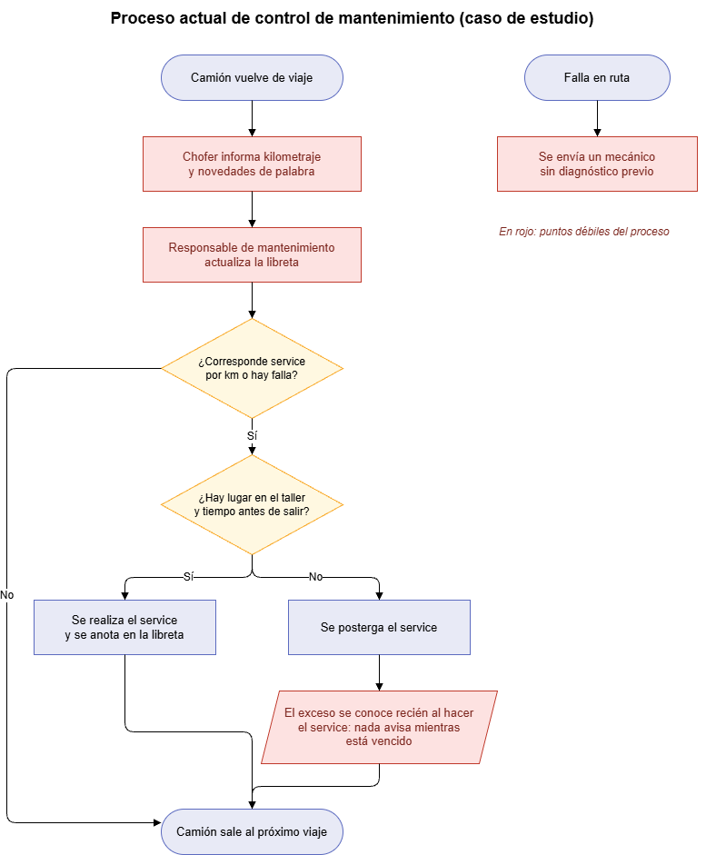

### 1.2 Usuarios y actores

| Actor | Rol en el sistema | Interés principal |
|---|---|---|
| Administrador de flota | Usuario `admin` | Visión unificada de toda la flota, propia y de terceros. |
| Responsable de mantenimiento | Usuario `mantenimiento` | Saber qué unidad necesita qué service, registrar lo realizado y ver fallas antes de que el camión vuelva. |
| Dispositivo telemétrico | Sistema externo | Enviar lecturas del vehículo de forma confiable. |
| Temporizador | Proceso interno | Detectar dispositivos que dejaron de reportar. |
| Fleteros y choferes | Interesados (no usan el sistema) | Dejar de ser la única fuente de datos del estado del camión. |

### 1.3 Evidencia utilizada para validar el problema

- **Entrevista** a un mecánico que trabajó en el taller de la empresa (22/09/2026; datos vigentes hasta febrero de 2026). Ficha completa en el [Anexo A de la 1ª Entrega](01-propuesta-proyecto.md#anexo-a-ficha-de-la-entrevista). Hallazgos principales:
  - El kilometraje para programar services se anota a mano en una libreta, que lleva principalmente una persona; cuando la llevaron varias hubo desorganización.
  - Se postergaron services por falta de lugar en el taller o por salidas urgentes, y el exceso se conocía recién al hacerlos.
  - Ante fallas en ruta se envió un mecánico a cientos de kilómetros sin diagnóstico previo.
  - El dueño usaba con frecuencia la plataforma del fabricante cuando la tenía disponible.
- **Cuantificación del control manual:** con los intervalos relevados y un recorrido de 3.500–4.000 km semanales, las 15 unidades sin telemetría suman **unas 120 intervenciones por año** que se programan por kilometraje.
- **Evidencia de mercado:** las plataformas de Scania, Mercedes-Benz (Fleetboard) y Volvo (Volvo Connect) confirman que el dato del vehículo tiene valor para el transportista, y a la vez dependen del equipo de fábrica de las unidades recientes.

### 1.4 Necesidad concreta

Capturar de forma automática, **independiente de la marca y del dueño del camión**, el kilometraje y los códigos de falla de cada unidad, y usarlos para calcular el estado de mantenimiento de toda la flota en un solo panel, con alertas mientras un service está próximo, vencido o postergado.

---

## 2. Objetivos y alcance

### 2.1 Objetivo general

Desarrollar un sistema de telemetría que capture automáticamente el kilometraje y los códigos de falla de vehículos de distintas marcas y los use para controlar el mantenimiento preventivo de una flota mixta desde una plataforma web única.

### 2.2 Alcance finalmente implementado

| Objetivo específico (1ª Entrega) | Estado | Qué se implementó |
|---|---|---|
| 1. Prototipo de dispositivo (ESP32 + interfaz OBD) que lea J1939 y J1979 y publique por MQTT | **No implementado** | Se reemplazó por un **simulador de camiones** que publica en el broker de producción con el mismo contrato MQTT que el firmware (ver 2.3). |
| 2. Backend que reciba, valide y persista lecturas y calcule el estado de mantenimiento | **Completo** | API REST, ingesta MQTT y temporizador (módulos M1–M9), desplegados en producción. |
| 3. Dashboard web para consultar la flota, registrar services y postergar tareas | **Completo** | Flota, detalle de unidad, alertas, services, postergaciones, kilometraje manual, historial, analíticas y administración. |
| 4. Validación del sistema completo en un entorno simulado | **Completo** | Simulador de camiones contra producción, tests automatizados de backend, frontend y simulador, y CI en GitHub Actions. |

Los 17 requerimientos funcionales (RF01–RF17) de la 1ª Entrega están implementados en el backend y el frontend. Se agregó una funcionalidad no prevista: la pantalla de **analíticas de la flota** (indicadores y gráficos).

### 2.3 Funcionalidades que quedaron fuera y motivo del recorte

| Funcionalidad | Motivo |
|---|---|
| **Firmware del dispositivo** (ESP32 + SparkFun OBD-II UART + módulo 4G) | Se priorizó que la plataforma estuviera completa, probada y desplegada. Para no perder la validación de punta a punta, se construyó un simulador que reproduce el comportamiento del dispositivo y cuyo cumplimiento del contrato se verifica con un test contra el parser real del backend. |
| Almacenamiento de lecturas sin señal en el dispositivo (RNF02, lado del firmware) | Depende del firmware. El backend sí está preparado: procesa lecturas atrasadas con su marca de tiempo original sin marcarlas como inconsistentes. |
| Validación con un vehículo liviano real y banco J1939 (niveles 1 y 2 de la estrategia de validación) | Requieren el firmware. Queda como trabajo futuro (sección 7.4). |
| Fuera de alcance desde la 1ª Entrega | Geolocalización, monitoreo del equipo de frío, estilo de manejo, notificaciones externas, integración con plataformas de fabricantes, gestión de repuestos y costos, e instalación en camiones reales. |

---

## 3. Análisis y modelo

### 3.1 Entidades principales y relaciones

El modelo es **relacional** (PostgreSQL), porque el dominio tiene relaciones fijas con integridad referencial importante: un dispositivo vinculado a lo sumo a una unidad, un service que cierra las postergaciones abiertas, etc. Son 12 tablas más una vista; el detalle de cada columna está en la [2ª Entrega, sección 2](02-arquitectura-modulos.md#2-esquema-de-base-de-datos) y el DDL en [`db/schema.sql`](../../db/schema.sql).

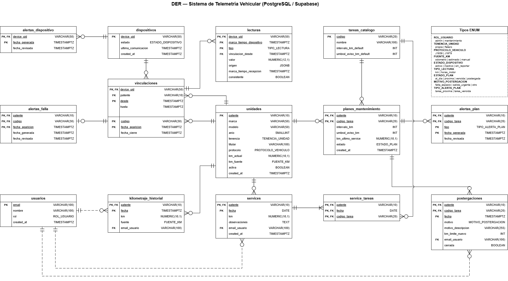

| Entidad | Qué representa | Clave |
|---|---|---|
| `unidades` | Cada camión de la flota, propio o de fletero, con su protocolo y kilometraje actual. | `patente` |
| `dispositivos` | Cada equipo telemétrico, con su estado y última comunicación. | `device_uid` |
| `vinculaciones` | Historial de qué dispositivo estuvo en qué unidad y cuándo. | `(device_uid, desde)` |
| `lecturas` | Kilometraje y horas de motor informados por los dispositivos. | `(device_uid, marca_tiempo_dispositivo, tipo)` |
| `tareas_catalogo` | Tipos de tarea con sus intervalos por defecto. | `codigo` |
| `planes_mantenimiento` | Una tarea aplicada a una unidad; guarda su estado calculado. | `(patente, codigo_tarea)` |
| `services` / `service_tareas` | Visita al taller y las tareas que cubrió. | `(patente, fecha)` |
| `postergaciones` | Postergaciones de un plan, con motivo y nuevo límite. | `(patente, codigo_tarea, fecha)` |
| `fallas` | Códigos de falla (DTC) con su aparición y cierre. | `(patente, codigo, fecha_aparicion)` |
| `alertas_plan`, `alertas_falla`, `alertas_dispositivo` | Alertas según su origen, unificadas en la vista `alertas`. | Según el origen |
| `kilometraje_historial` | Cargas manuales de kilometraje. | `(patente, fecha)` |
| `usuarios` | Usuarios del sistema y su rol. | `email` |

### 3.2 Reglas de negocio relevantes

| ID | Regla |
|---|---|
| RN02 | Una unidad tiene como máximo un dispositivo activo, y un dispositivo está vinculado como máximo a una unidad. |
| RN04 | Una tarea está **vencida** cuando el km actual alcanza o supera el km del último service más el intervalo. |
| RN05 | Una tarea está **próxima** cuando faltan menos km que el umbral de aviso (4.000 km por defecto, una semana de operación). |
| RN06 | Registrar un service reinicia la cuenta de sus tareas y cierra las postergaciones abiertas. |
| RN07 | Postergar exige motivo y nuevo límite; la tarea vuelve a estar vencida si se supera ese límite. |
| RN08 | El km se toma del odómetro (J1939), se estima integrando la velocidad (J1979) o se carga a mano, y siempre se registra la fuente. |
| RN09 | El km de una unidad no puede disminuir: una lectura menor se guarda como inconsistente y no actualiza el km. |
| RN10 | Un dispositivo sin reportar por más de 24 h genera una alerta. |
| RN11 | Solo el administrador gestiona unidades, dispositivos, usuarios y planes; ambos roles registran services, postergaciones y km manual. |
| RN12 | Cada código de falla nuevo genera una alerta; la falla se cierra cuando el dispositivo deja de informarla. |

Las reglas RN04 a RN07 definen el ciclo de vida de cada tarea:

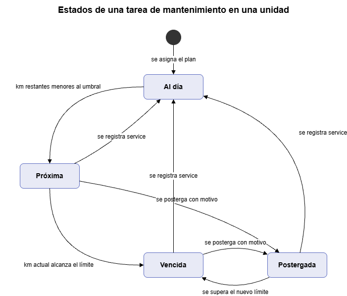

### 3.3 Decisiones de modelado importantes

- **Claves naturales.** Cada tabla se identifica por sus datos (patente, `device_uid`, email, código de tarea) y no por ids generados. Las relaciones se leen en términos del dominio y la propia clave impide duplicados, por ejemplo asignar dos veces la misma tarea a una unidad.
- **Historial temporal de vinculaciones.** En vez de guardar el dispositivo actual como atributo de la unidad, `vinculaciones` registra cada intervalo de instalación. Restricciones `EXCLUDE` sobre rangos de tiempo impiden dos vinculaciones simultáneas del mismo dispositivo o de la misma unidad (RN02). Así cada lectura queda asociada a la unidad correcta aunque el dispositivo se haya movido.
- **Una tabla de alertas por origen.** Plan, falla y dispositivo tienen claves distintas; separarlas evita columnas vacías en la clave. Una vista las une para el dashboard.
- **Estado del plan persistido.** `planes_mantenimiento` guarda `km_ultimo_service` y `estado`, que se recalculan ante cada lectura, service o postergación, en lugar de recalcular todo el historial en cada consulta.
- **Estados derivados de fechas no se duplican.** Una falla está activa mientras no tiene `fecha_cierre` y una alerta está abierta mientras no tiene `fecha_revisada`; no hay un campo `estado` que pueda contradecirlas.
- **Modelo agnóstico del protocolo.** El detalle del parámetro de origen (PGN/SPN de J1939 o PID de J1979) se guarda en `lecturas.origen` (JSONB), sin acoplar el esquema a un protocolo (RNF08, RNF09).
- **Bajas lógicas.** Unidades, usuarios, tareas del catálogo y planes se dan de baja con un indicador (`activa`/`activo`) en lugar de borrarse, para conservar el historial (RNF11). Se incorporaron con la migración [`db/migraciones/001-bajas-logicas.sql`](../../db/migraciones/001-bajas-logicas.sql).

---

## 4. Arquitectura y tecnologías

### 4.1 Arquitectura final

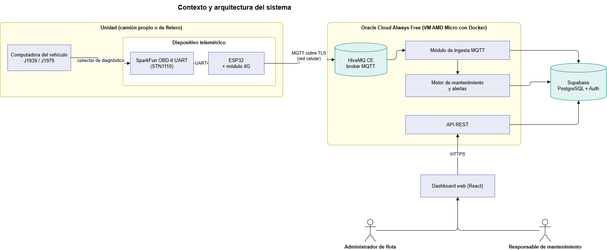

```
Simulador de camiones (reemplaza al ESP32 + OBD-II + 4G)
        │  MQTT sobre TLS (8883)
        ▼
┌─ VM Oracle Cloud Always Free (Docker Compose) ─────────────────┐
│  HiveMQ CE  →  Backend Node.js  ←  Caddy (HTTPS)               │
│               (ingesta + motor + API REST)                     │
└────────────────────────────────────────────────────────────────┘
        │                                   ▲
        ▼                                   │
 Supabase (PostgreSQL + Auth)      Dashboard web (React)
```

Todo el backend, el broker y el servidor web corren en **una sola VM** con Docker Compose, con un límite de memoria por contenedor. El dashboard y la API comparten dominio, por lo que no hay problemas de CORS en producción. La base de datos y la autenticación son servicios administrados de Supabase.

### 4.2 Componentes, responsabilidades y justificación

| Componente | Tecnología | Responsabilidad | Por qué se eligió |
|---|---|---|---|
| Simulador de camiones | Python 3.11, paho-mqtt | Reproduce jornadas de camiones (J1939 y J1979), acumula km y horas de motor, abre y cierra fallas, y publica por MQTT/TLS como lo haría el dispositivo. | Permite validar el circuito completo sin hardware. Python ofrece un cliente MQTT maduro y se usa en el día a día de uno de los integrantes. |
| Broker MQTT | HiveMQ CE + extensión File RBAC | Recibe los mensajes de los dispositivos y los entrega al backend. Un usuario por dispositivo con permiso solo de publicación sobre su topic. | MQTT es liviano para enlaces celulares inestables y desacopla el dispositivo del backend. HiveMQ CE reemplazó a HiveMQ Cloud cuando este dejó de ofrecer un plan gratuito (RNF12). |
| Backend | Node.js 22+, TypeScript, Express 5, postgres.js, mqtt.js | En un solo proceso: API REST (`/api/v1`), ingesta MQTT y temporizador de dispositivos. | La E/S no bloqueante sostiene el listener MQTT y la API en el mismo proceso. TypeScript permite compartir el contrato tipado con el frontend. Express alcanza para el tamaño de la API; NestJS resultaba excesivo. |
| Base de datos y autenticación | Supabase (PostgreSQL 17 + Auth) | Persistencia relacional y gestión de usuarios y sesiones. | Un único servicio cubre datos relacionales, semiestructurados (JSONB) y autenticación, en un plan gratuito. |
| Servidor web | Caddy | Sirve el dashboard compilado y hace de proxy a la API, con HTTPS y certificados automáticos de Let's Encrypt. | Configuración mínima y renovación automática de certificados. |
| Frontend | React 19, TypeScript, Vite, Tailwind CSS, TanStack Query, ECharts | Dashboard: flota, detalle, alertas, mantenimiento, analíticas y administración. | Ecosistema maduro para dashboards, diseño responsive para usar desde el taller (RNF10). TanStack Query maneja caché, reintentos y refresco. |
| Infraestructura | Oracle Cloud Always Free (VM AMD Micro, 1 GB RAM + 2 GB swap), Docker Compose | Aloja backend, broker y Caddy de forma continua. | El ingestor MQTT debe estar siempre activo; las opciones PaaS gratuitas evaluadas (Render, Railway) suspenden los procesos inactivos. Se usó la forma AMD Micro porque no había capacidad ARM en la región. |
| Integración continua | GitHub Actions | Ejecuta en cada push y pull request los tests de backend (con PostgreSQL real), frontend y simulador. | Evidencia automática y reproducible de que las pruebas pasan. |

### 4.3 Integraciones realizadas

- **Dispositivo/simulador → broker → backend (MQTT).** Topic `telemetria/<device_uid>/lecturas`, QoS 1, TLS. El contrato del mensaje es agnóstico del protocolo del vehículo ([2ª Entrega §3.2](02-arquitectura-modulos.md#32-contrato-del-mensaje-mqtt)):
  ```json
  {
    "device_uid": "esp32-SIM002",
    "protocolo": "J1939",
    "timestamp": "2026-11-11T01:31:18Z",
    "lecturas": [
      { "tipo": "km", "valor": 41250.0, "origen": { "pgn": 65248 } },
      { "tipo": "horas_motor", "valor": 590.5, "origen": { "pgn": 65253 } },
      { "tipo": "dtc", "codigo": "SPN-110-FMI-0", "activo": true, "origen": { "pgn": "DM1" } }
    ]
  }
  ```
- **Frontend → backend (REST).** Contrato único en [`docs/openapi.yaml`](../openapi.yaml), compartido por el backend, el mock y el frontend. Los tipos TypeScript del frontend se generan desde ese archivo y el CI verifica que estén al día.
- **Frontend y backend → Supabase Auth.** El dashboard inicia sesión con Supabase; el backend valida el token de cada request contra Supabase Auth y busca el rol del usuario en su propia tabla `usuarios`.
- **Backend → PostgreSQL.** Conexión directa con la cadena de conexión de Supabase (session pooler, SSL).

### 4.4 Seguridad, autorización y concurrencia

**Autenticación y autorización**
- Toda la API requiere un token válido de Supabase Auth; sin token responde 401, y un email no habilitado en `usuarios` recibe 403 (RNF04).
- Cada operación verifica el rol (RN11): un usuario `mantenimiento` no accede a la administración. Un usuario dado de baja pierde el acceso; no se puede dar de baja a uno mismo ni al último administrador.
- El modo de sesión simulado de desarrollo (`dev`) está **prohibido en producción**, tanto en el backend como en el build del frontend.

**Acceso a datos**
- Row Level Security está habilitado en todas las tablas **sin políticas**: ningún cliente accede directo a la base. Solo el backend se conecta; el dashboard usa Supabase únicamente para iniciar sesión, con la clave pública `anon`.

**Mensajería**
- MQTT sobre TLS (puerto 8883), con un usuario por dispositivo y permiso de publicación solo sobre su topic (RNF03). El backend tiene un usuario aparte con permiso solo de suscripción.
- El certificado del broker se renueva automáticamente con una tarea programada en la VM.

**Secretos**
- Credenciales, claves y contraseñas del broker quedan fuera del repositorio; las variables se documentan en archivos `.env.example`.

**Concurrencia, duplicados y orden**
- **Mensajes duplicados (QoS 1).** El broker puede entregar un mensaje más de una vez; la clave primaria de `lecturas` lo rechaza, de modo que el reintento no duplica datos.
- **Orden.** Los mensajes se procesan en paralelo entre dispositivos y **en orden dentro de cada dispositivo**, con un timeout de 30 s por mensaje.
- **Caídas del backend.** La sesión MQTT es persistente: si el backend está caído, el broker guarda los mensajes y los entrega al reconectar.
- **Lecturas atrasadas vs. RN09.** Una lectura enviada tarde (por ejemplo, tras estar sin señal) se procesa con su marca de tiempo original y no se marca inconsistente; solo es inconsistente un km menor en la lectura **más nueva**.
- **Vinculaciones simultáneas.** Las restricciones `EXCLUDE` de la base impiden dos vinculaciones solapadas aunque dos operaciones lleguen a la vez.
- **Alertas sin duplicar.** Una alerta se genera solo en la transición de estado (por ejemplo, de *al día* a *próxima*), y marcar una alerta como revisada es idempotente.

---

## 5. Implementación

### 5.1 Principales módulos desarrollados

| Módulo | Responsabilidad | Implementación |
|---|---|---|
| M1 — Autenticación y autorización | Sesión y control de rol. | `backend/src/auth/`, `modulos/usuarios/` |
| M2 — Unidades y dispositivos | Alta, edición, baja y vinculación con historial. | `modulos/unidades/`, `modulos/dispositivos/` |
| M3 — Ingesta MQTT | Validación del mensaje, resolución de la vinculación vigente, persistencia de lecturas y fallas, actualización del km. | `modulos/ingesta/` (parser, procesador y cliente MQTT) |
| M4 — Motor de mantenimiento | Catálogo, planes por unidad y cálculo del estado (RN04, RN05, RN07). | `modulos/mantenimiento/` |
| M5 — Services y postergaciones | Registro y reinicio de planes (RN06, RN07). | `modulos/services/`, `modulos/postergaciones/` |
| M6 — Fallas | Apertura y cierre de códigos de falla (RN12). | `modulos/fallas/` |
| M7 — Alertas | Consulta y revisión de alertas de los tres orígenes. | `modulos/alertas/` |
| M8 — Temporizador | Detección de dispositivos sin reportar (RN10). | `modulos/temporizador/` |
| M9 — API y dashboard | Vista de flota, detalle, historial, km manual y pantallas del frontend. | `backend/src/modulos/`, `frontend/src/features/` |
| Simulador de camiones | Reemplazo del dispositivo para la validación y la demo. | `simuladores-mock/` |

El frontend está organizado por funcionalidad (`fleet`, `alerts`, `admin`, `analytics`, `session`), cada una con sus páginas, componentes, hooks y servicios.

### 5.2 Recorridos y casos de uso importantes

**CU06 - Transmitir lecturas (circuito completo).**
1. El simulador publica un mensaje con km, horas de motor y, si corresponde, un código de falla.
2. HiveMQ verifica el usuario del dispositivo y su permiso sobre el topic, y entrega el mensaje al backend.
3. El backend valida el mensaje, busca la vinculación vigente a la fecha de la lectura y guarda las lecturas.
4. Si hay km, actualiza el km de la unidad (con su fuente: odómetro o estimado) y recalcula cada plan de mantenimiento.
5. Si un plan cambió a *próxima* o *vencida*, o apareció una falla nueva, se genera una alerta.
6. El dashboard muestra el km actualizado, el estado del plan y la alerta.

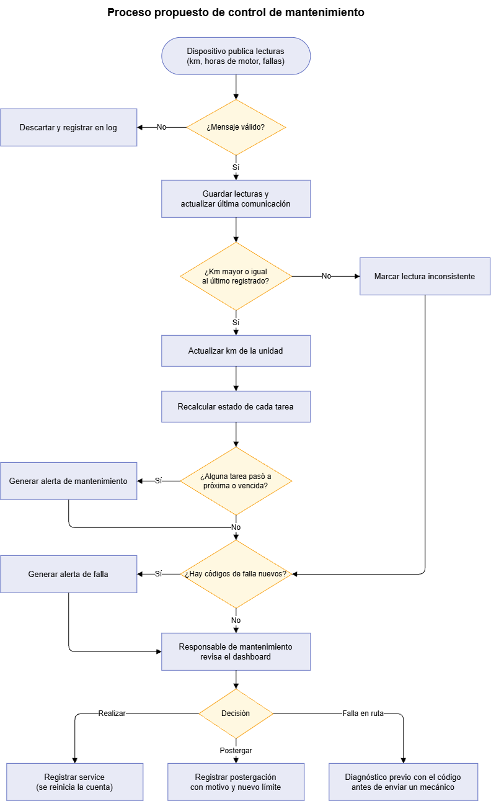

**CU09 - Registrar service.** Desde el detalle de la unidad, el responsable de mantenimiento selecciona las tareas realizadas, la fecha, el km y observaciones. El sistema reinicia la cuenta de esas tareas, cierra sus postergaciones y alertas, y, si el km informado es mayor al actual, lo actualiza.

**CU10 - Postergar tarea.** Sobre una tarea próxima o vencida, el usuario indica el motivo (falta de lugar, salida urgente u otro con descripción) y el nuevo límite en km. La tarea pasa a *postergada* y vuelve a *vencida* si se supera ese límite.

**CU14 - Detectar dispositivos sin reportar.** Cada 5 minutos el temporizador busca dispositivos sin comunicación por más de 24 h, los marca *sin reportar* y genera una única alerta; cuando el dispositivo vuelve a comunicarse, pasa a *activo*.

**Capturas del sistema en producción**

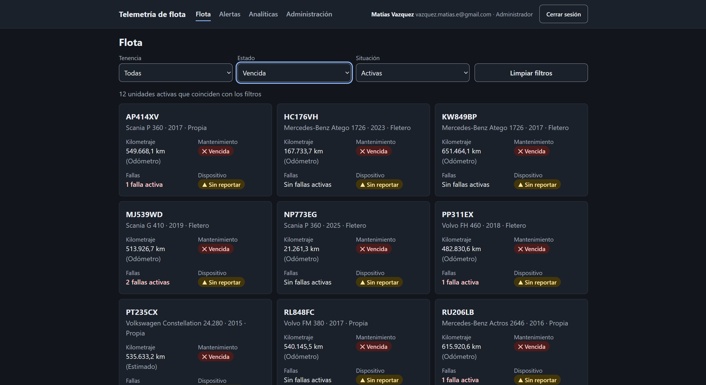
*Vista de la flota (CU07) filtrada por unidades con mantenimiento vencido: km y su fuente, estado, fallas activas y estado del dispositivo.*

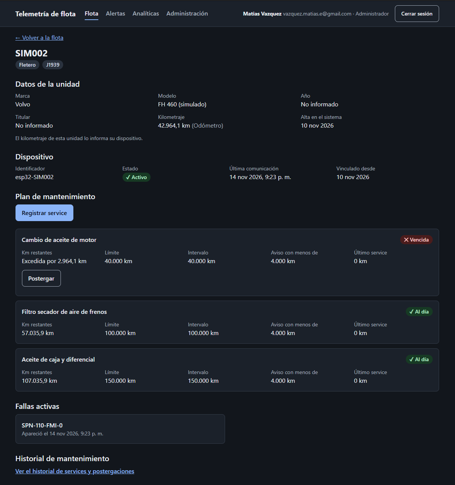
*Detalle de SIM002 (CU08): cambio de aceite vencido, el resto del plan al día y una falla activa informada por el dispositivo.*

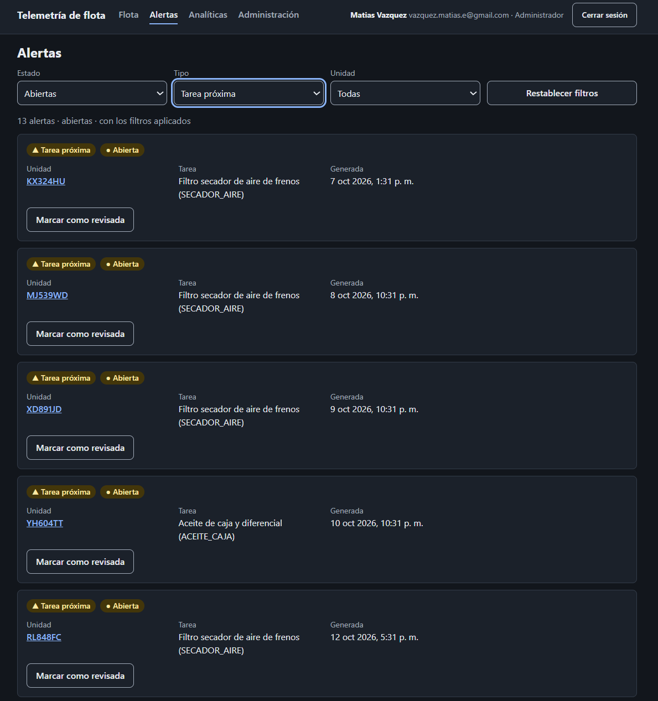
*Alertas abiertas (CU12) filtradas por tipo, con la unidad, la tarea y la fecha en que se generaron.*

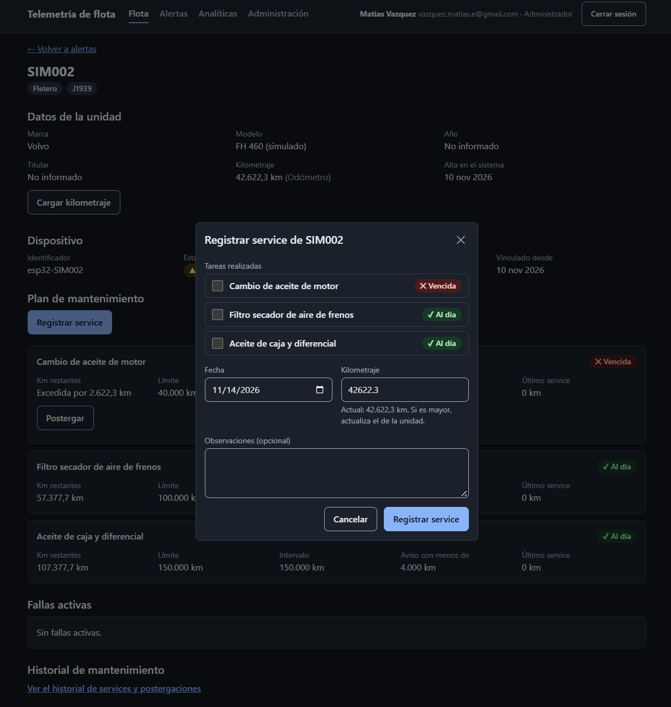
*Registrar service (CU09): el sistema propone las tareas del plan con su estado y el kilometraje actual de la unidad.*

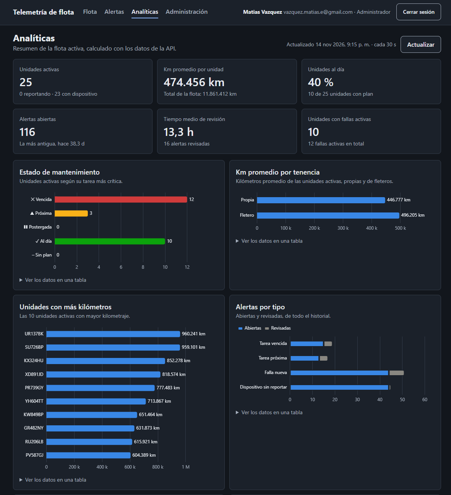
*Analíticas: indicadores y gráficos calculados con los datos de la API.*

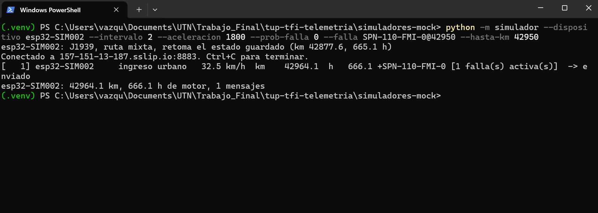
*Simulador de camiones publicando por MQTT/TLS en el broker de producción (reemplazo del dispositivo, CU06).*

### 5.3 Dificultades técnicas y cómo se resolvieron

| Dificultad | Solución |
|---|---|
| HiveMQ Cloud dejó de ofrecer un plan gratuito, lo que contradecía el requerimiento de costo (RNF12). | Se autoalojó HiveMQ CE en la misma VM, con TLS hacia afuera y la extensión File RBAC para tener un usuario por dispositivo con permisos por topic. |
| No había capacidad para la VM ARM gratuita (A1.Flex) en la región. | Se usó la VM AMD Micro gratuita (1 GB de RAM), con 2 GB de swap y un límite de memoria por contenedor (API 256 MB, HiveMQ 400 MB, Caddy 64 MB). |
| Las plataformas PaaS gratuitas suspenden los procesos inactivos, lo que corta el listener MQTT. | Se eligió una VM propia siempre encendida, con Docker Compose y reinicio automático de los contenedores. |
| Mensajes duplicados por la garantía "al menos una vez" de QoS 1. | Idempotencia por la clave primaria de `lecturas`. |
| Conciliar la regla "el km no disminuye" (RN09) con lecturas que llegan tarde tras estar sin señal. | La consistencia se evalúa contra la lectura más nueva: una lectura atrasada se guarda como consistente y no modifica el km actual. |
| Riesgo de que frontend, backend y mock divergieran en el contrato de la API. | Contrato OpenAPI único; tipos del frontend generados desde él y verificados en el CI. |
| Determinar qué día es "hoy" para services y postergaciones con el servidor en UTC. | Zona horaria configurable (`America/Argentina/Buenos_Aires`) para las fechas del dominio. |
| Sin hardware, validar igualmente el circuito de punta a punta. | Simulador que publica en el broker de producción con el contrato del firmware, y un test que valida sus mensajes contra el parser real del backend. |


---

## 6. Pruebas y validación

### 6.1 Qué aspectos se probaron

| Suite | Tipo | Qué cubre | Casos (`v1.0.0`) |
|---|---|---|---|
| Backend | Unitarias e integración contra PostgreSQL real | Parser del contrato MQTT, reglas de mantenimiento, API completa por módulo, ingesta, temporizador y bajas lógicas. Cada suite crea una base temporal con el esquema y los datos de ejemplo. | 37 |
| Frontend | Unitarias | Servicios de la API, formularios y validaciones, filtros, sesión, redirecciones y cálculos de analíticas. | 329 |
| Simulador | Unitarias e integración | Modelo del camión, mensajes, transporte MQTT con un mini-broker real y validación de los mensajes contra el parser del backend. | 47 |

Las tres suites corren en **GitHub Actions** en cada push y pull request (los badges del README muestran su estado). La suite del backend corre contra un PostgreSQL 17 real levantado por el CI.

### 6.2 Casos de prueba relevantes y reglas críticas

| Regla crítica | Cómo se comprueba | Prueba |
|---|---|---|
| Cálculo de estados (RN04, RN05, RN07) | Casos límite: al día cuando faltan más km que el umbral; **justo en el umbral sigue al día**; próxima por debajo del umbral; vencida al alcanzar el intervalo; postergada que vuelve a vencida al superar el nuevo límite. | `backend/test/unit/reglas.test.ts` |
| Alertas sin duplicar (RF12) | Bajar el intervalo de un plan lo pasa a *próxima* y genera **una sola** alerta; solo *próxima* y *vencida* generan alerta. | `reglas.test.ts`, `api.test.ts` |
| Idempotencia de MQTT (QoS 1) | Un mensaje repetido no duplica lecturas. | `ingesta.test.ts` |
| Km que no disminuye (RN09) | Un km menor en la lectura más nueva se guarda inconsistente y no baja el km; una lectura vieja que llega tarde es consistente y tampoco lo baja. La carga manual tampoco puede disminuir. | `ingesta.test.ts`, `api.test.ts` |
| Ciclo de vida de fallas (RN12) | Abre con alerta, no se duplica, se cierra y puede reaparecer como un nuevo registro. | `ingesta.test.ts` |
| Dispositivos sin reportar (RN10) | El temporizador marca *sin reportar* con una sola alerta y el dispositivo vuelve a *activo* al reportar. | `ingesta.test.ts` |
| Vinculación (RN02) | No se permiten dos vinculaciones simultáneas y se conserva el historial; no se puede dar de baja una unidad con dispositivo vinculado. | `api.test.ts` |
| Service (RN06, RN08) | Reinicia el plan, cierra la postergación y actualiza el km. | `api.test.ts` |
| Seguridad y roles (RN11) | 401 sin token, 403 con email no habilitado, `mantenimiento` sin acceso a administración, usuario dado de baja sin acceso. | `api.test.ts` |
| Robustez de la ingesta | Mensajes inválidos y dispositivos desconocidos se descartan sin detener la ingesta; lecturas de tipo desconocido se ignoran sin descartar el resto. | `parser.test.ts`, `ingesta.test.ts` |
| Contrato del dispositivo | Los mensajes generados por el simulador pasan por el `parser.ts` real del backend. | `simuladores-mock/tests/test_contrato_backend.py` |

### 6.3 Evidencia de funcionamiento en producción

El 10/11/2026 se cargó en producción una flota de demostración y se la hizo circular con el simulador conectado al broker por internet (TLS), del mismo modo que lo haría el dispositivo. El 14/11/2026 se hizo una corrida corta adicional de SIM002 para dejar una falla activa para la demostración:

| Unidad | Protocolo | Configuración | Resultado obtenido |
|---|---|---|---|
| SIM001 | J1939 | Aceite de motor cada 40.000 km, aviso 4.000. Recorrido hasta ~37.000 km. | Tarea **próxima** y alerta generada. |
| SIM002 | J1939 | Aceite de motor, secador y aceite de caja con valores por defecto. Recorrido hasta ~42.000 km con una falla forzada (SPN-110-FMI-0). | Aceite **vencida**, las otras tareas **al día**; la falla forzada abrió su alerta y luego se cerró sola (RN12), y una segunda corrida la dejó activa para la demostración. |
| SIM003 | J1979 | Aceite de motor con plan propio (20.000 / 2.000). Recorrido hasta ~15.000 km. | Tarea **al día** y km con fuente **estimado** (RN08). |

Métricas registradas durante la corrida del 10/11/2026 (endpoint `/health` y `docker stats` en la VM):

| Métrica | Valor |
|---|---|
| Mensajes recibidos / procesados | 209 / 209 |
| Mensajes descartados / con error | 0 / 0 |
| Pico de memoria de la API | 70 MB de 256 MB (27 %) |
| Pico de memoria de HiveMQ | 154 MB de 400 MB (38 %) |
| Pico de CPU de la API | 14 % (puntual, al procesar) |

### 6.4 Validación con usuarios o con el caso real

No se realizó una validación con usuarios finales ni con los vehículos del caso de estudio, porque el equipo no tiene acceso a ellos (ver 1.1). La validación se basó en los datos relevados en la entrevista: los intervalos de mantenimiento del catálogo, el umbral de aviso de una semana de operación y el perfil de recorrido del simulador.

### 6.5 Resultados de las pruebas

- Las tres suites pasan en el CI sobre la versión entregada.
- El circuito de punta a punta (simulador → broker → backend → base → dashboard) funcionó en producción sin pérdidas ni descartes.
- Con tres dispositivos publicando, la VM gratuita usó menos del 40 % de la memoria asignada a cada contenedor.
- **No se midió formalmente** la capacidad pedida por RNF07 (50 unidades con una lectura por minuto) ni el tiempo de carga de RNF06; las métricas anteriores son un indicio favorable, no una prueba de carga.

---

## 7. Resultados y conclusiones

### 7.1 Qué resolvió efectivamente el proyecto

El sistema reemplaza la libreta por un control **automático, compartido y con un solo criterio para toda la flota**: calcula el estado de cada tarea de mantenimiento de cada unidad a partir de su kilometraje, avisa mientras un service está próximo o vencido, registra cada postergación con su motivo y muestra los códigos de falla de una unidad antes de que vuelva al taller. Todo esto funciona hoy en producción con datos que llegan por MQTT con el mismo contrato que usaría el dispositivo real.

### 7.2 Qué cambió respecto de la situación inicial

| Antes (caso de estudio) | Con el sistema |
|---|---|
| Kilometraje anotado a mano al volver cada camión. | Kilometraje actualizado con cada mensaje del dispositivo, con su fuente registrada. |
| El control depende de una persona y de su libreta. | Estado de toda la flota visible para cualquier usuario autorizado. |
| El exceso de un service postergado se conoce al hacerlo. | La tarea figura como postergada con motivo y límite, y vuelve a vencida si se supera. |
| Fallas en ruta conocidas solo por el relato del chofer. | Cada código de falla nuevo genera una alerta con la unidad y el código. |
| Una plataforma por marca, solo para unidades recientes. | Un panel único, independiente de la marca y de la tenencia. |

### 7.3 Limitaciones conocidas

- **Sin dispositivo físico.** Las lecturas las genera el simulador; la lectura real de J1939 y J1979 desde el vehículo no se probó.
- **Lecturas soportadas.** Se persisten kilometraje, horas de motor y códigos de falla; otras lecturas (velocidad, rpm, GPS) se ignoran.
- **Analíticas en el cliente.** Se calculan en el navegador con lo que expone la API; no hay endpoints de agregados ni historial de lecturas de km por unidad.
- **Infraestructura gratuita.** La VM tiene 1 GB de RAM y la base usa el plan gratuito de Supabase; alcanza para el prototipo, no para una flota productiva.
- **Capacidad y rendimiento no medidos formalmente** (RNF06, RNF07).
- **Sin validación con usuarios finales** del caso de estudio.

### 7.4 Evolución futura

1. **Firmware del dispositivo** sobre el contrato MQTT ya definido y validado: lectura de PGN 65248/65253 y DM1 en J1939, PIDs en J1979, buffer de lecturas sin señal (RNF02) y conexión 4G con TLS.
2. **Validación física:** primero en un vehículo liviano (J1979) y luego en un banco con transceptor CAN para J1939, según la estrategia de la 1ª Entrega.
3. **Notificaciones** por correo o mensajería ante alertas críticas.
4. **Endpoints de agregados e historial de km** para analíticas de largo plazo.
5. **Pruebas de carga** para verificar RNF06 y RNF07, y evaluar un plan pago o una base propia para producción.

### 7.5 Aprendizajes y decisiones relevantes

- Definir temprano un **contrato** (mensaje MQTT y OpenAPI) permitió que backend, frontend, mock y simulador avanzaran en paralelo y se integraran sin sorpresas.
- Las **reglas de negocio con casos límite** (por ejemplo, qué pasa justo en el umbral) conviene fijarlas con tests antes de construir la interfaz.
- Las restricciones de un plan gratuito (memoria, broker, suspensión de procesos) **condicionan la arquitectura** tanto como los requerimientos funcionales.
- Ante el riesgo del hardware, **un simulador que respeta el contrato** permitió entregar un sistema validado de punta a punta y dejar el firmware como una pieza reemplazable.

### 7.6 Implementado y probado vs. trabajo futuro

| Implementado y probado | Trabajo futuro |
|---|---|
| Backend completo (M1–M9), con tests contra PostgreSQL real | Firmware del dispositivo |
| Dashboard completo, incluidas analíticas y administración | Validación en vehículo liviano y banco J1939 |
| Ingesta MQTT con TLS, usuarios por dispositivo y sesión persistente | Buffer de lecturas sin señal en el dispositivo (RNF02) |
| Simulador de camiones validado contra el parser del backend | Notificaciones externas |
| Despliegue en producción con HTTPS y renovación de certificados | Agregados e historial de km en la API |
| CI con las tres suites | Pruebas de carga (RNF06, RNF07) |

---

## Anexo A. Documentación de referencia

| Documento | Contenido |
|---|---|
| [README](../../README.md) | Instalación, ejecución, estructura, pruebas y limitaciones. |
| [1ª Entrega — Propuesta de proyecto](01-propuesta-proyecto.md) | Problema, evidencia, actores, requerimientos, reglas de negocio, casos de uso y ficha de la entrevista. |
| [2ª Entrega — Arquitectura y módulos](02-arquitectura-modulos.md) | Esquema de base de datos, módulos y contrato MQTT. |
| [Contrato de la API](../openapi.yaml) | Especificación OpenAPI. |
| [Despliegue](../despliegue.md) | Puesta en producción en Oracle Cloud. |
| [Simulador de camiones](../../simuladores-mock/README.md) | Uso del simulador y guía de despliegue. |
| [Diagramas](../diagramas/) | Diagramas en PNG y fuentes draw.io. |
